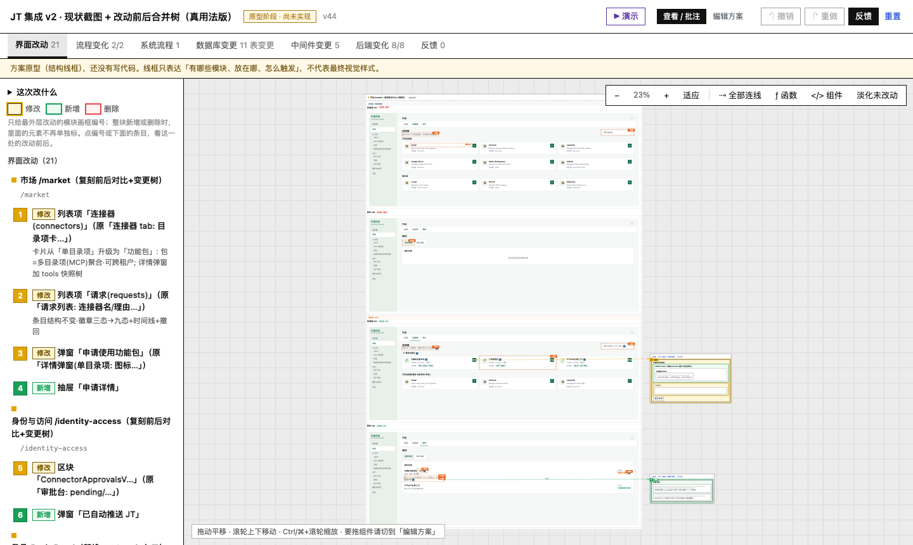
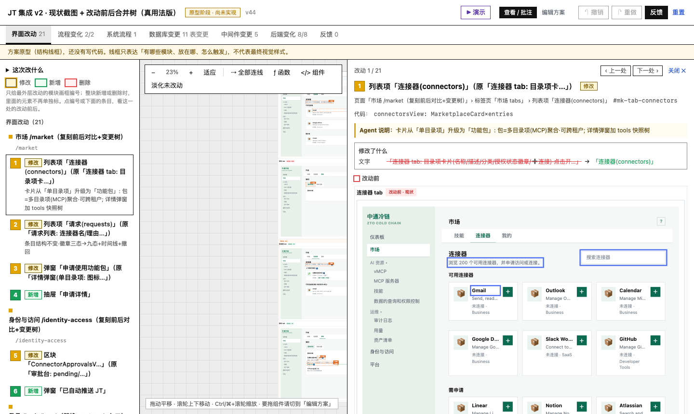
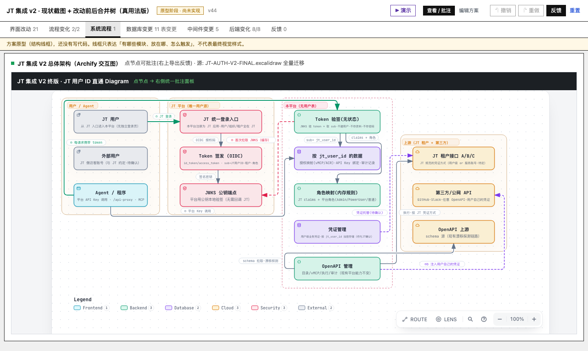
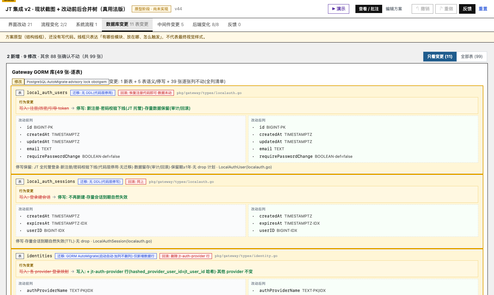
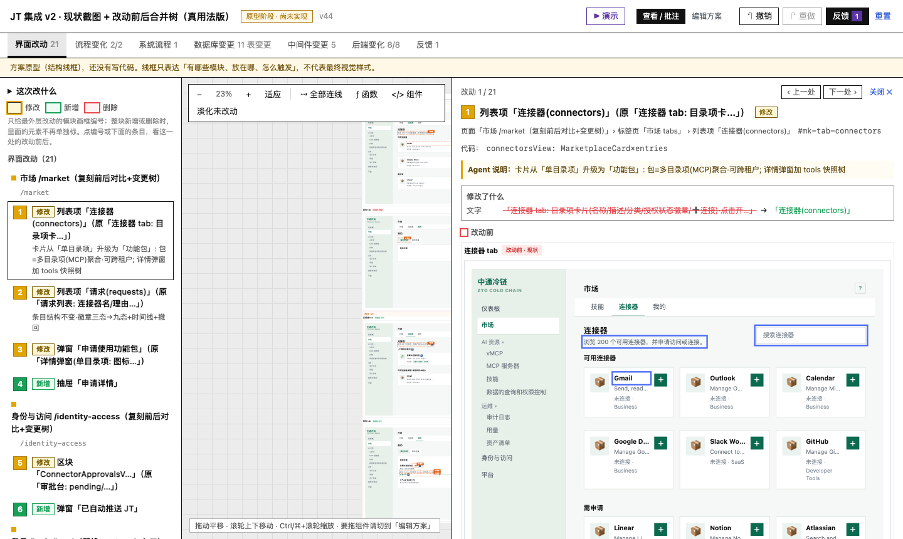

<div align="center">

# design-change-review

**方案确认原型工作台 —— 聊完需求之后、写代码之前的那一页**

[](../../actions)
[](LICENSE)
[](#安装)

任何技术栈 · 单文件离线 · 零运行时依赖

</div>

---

## 为什么需要它

技术方案评审最常见的失败方式：Agent 写了一份没人看的 Markdown，或者画了一张
讲不清"到底改哪里"的架构图。业务方真正需要的是——**在真实界面上看到改动前后，
逐表看清数据库变更，对任何一个元素直接说出意见**。

design-change-review 把一次方案变更（页面 / 流程 / 数据库 / 中间件 / 后端）
产出一个**单文件可交互 HTML**：业务方点选批注、试玩交互，结构化反馈一键复制
交回 Agent，落实到代码。

```
需求讨论 ──▶ Agent 写 spec ──▶ build ──▶ 单文件 preview.html
                                                    │
业务方评审（点选批注 / 演示模式）──▶ 复制反馈 ◀──────┘
                │
                ▼
        Agent apply-feedback ──▶ version+1 ──▶ 迭代至确认
```

## 它长什么样

**界面改动** —— 1:1 复刻真实 UI，改动前后对照，变更徽标由构建期注入（编号=清单=详情，单一事实源）：



点徽标打开改动单元详情：前后复刻小图、单屏提取、等比无截断、逐处写批注：



**系统流程** —— Archify 交互式架构图（可缩放/路径追踪），点节点即在外层标准批注面板写意见：



**数据库变更** —— 先盘点全量表、再逐表字段级 diff（`+` 新增 / `~` 修改附旧值 / `−` 删除 / `·` 不变），带 SQL 类型、DDL、迁移与回滚徽章：



**演示模式** —— 复刻页以真实 UI 演示原型交互（开弹窗 / 跳页 / 切状态）：



> 其余 tab：[流程变化](docs/screenshots/tab-flows.png) ·
> [中间件变更](docs/screenshots/tab-mw.png)（含"不引入 Kafka/Redis"决策块及量化依据） ·
> [后端变化](docs/screenshots/tab-backend.png) ·
> [反馈汇总](docs/screenshots/tab-feedback.png)

## 安装

**方式一：让 Agent 自己装（推荐，最省事）** —— 直接把这段发给你的 coding agent：

```
安装 design-change-review skill：
git clone https://github.com/Euraxluo/design-change-review.git ~/.agents/skills/design-change-review
装完读它的 SKILL.md 确认可用。
（可选，系统流程交互图）再装 Archify：
git clone --depth 1 https://github.com/tt-a1i/archify.git /tmp/archify-src
cp -r /tmp/archify-src/archify ~/.agents/skills/archify
node ~/.agents/skills/archify/bin/archify.mjs doctor 应输出 "Archify is ready."
```

Claude Code 用户也可以用 `npx skills` 安装器（支持 claude-code/codex/cursor/opencode 多目标）：

```
npx -y skills@latest add https://github.com/Euraxluo/design-change-review --skill design-change-review --agent claude-code --global --copy --yes
```

**方式二：手动安装**

```bash
git clone https://github.com/Euraxluo/design-change-review.git ~/.agents/skills/design-change-review
```

> 项目级安装（团队开箱一致，推荐团队用这个）：clone 到
> `<project>/.agents/skills/design-change-review`，评审产物落在
> `<project>/.agents/jdr/<日期>-<名称>/`，spec、preview、反馈全部跟仓库走，
> 队友 clone 即得同一套 skill 与历史评审。

装好后各平台的 skill 目录约定：

| Agent | 用户级目录 | 项目级目录 |
|---|---|---|
| Claude Code / OpenCode / Codex CLI | `~/.agents/skills/` | `<project>/.agents/skills/` |
| Cursor | `~/.cursor/skills/` 或 `~/.agents/skills/` | `<project>/.cursor/skills/` |

## 一句话上手

**已安装，直接说：**

> 用 design-change-review skill（位于 ~/.agents/skills/design-change-review，没找到就先 `git clone https://github.com/Euraxluo/design-change-review.git ~/.agents/skills/design-change-review`），把我们刚讨论的「XXX」方案做成确认原型（含页面改动前后、系统流程、数据库和中间件变更），构建完自测交互后给我 preview.html。

**English：**

> Use the design-change-review skill (at ~/.agents/skills/design-change-review; if missing, first `git clone https://github.com/Euraxluo/design-change-review.git ~/.agents/skills/design-change-review`) to turn the plan we just discussed into a confirmation prototype — UI before/after, system flow, DB & middleware changes — verify interactions, then hand me preview.html.

这句话自带兜底：**没装也会自己 clone 安装**。Agent 收到后的执行链：
读 `SKILL.md` → 按 `references/workflow.md` 盘点现状 → 写 spec → `build` + `embed` →
Playwright 自测 → 交付单文件原型。你评审后点「复制反馈」粘回去，再说一句
「落实反馈，version+1」即可进入下一轮。

## 快速开始

```bash
SKILL=~/.agents/skills/design-change-review

# 1. 写 spec（完整字段见 references/spec-format.md）
mkdir -p .agents/jdr/20260101-my-feature
$EDITOR .agents/jdr/20260101-my-feature/spec.json

# 2. 构建（校验+徽标注入，出错阻断）+ 截图内嵌
node $SKILL/scripts/build.mjs .agents/jdr/20260101-my-feature/spec.json
node $SKILL/scripts/embed.mjs  .agents/jdr/20260101-my-feature/preview.html

# 3. 交给业务方 → 他们点「复制反馈」粘贴回来
node $SKILL/scripts/apply-feedback.mjs feedback-v2.md .agents/jdr/20260101-my-feature/spec.json
```

（可选）系统流程用 Archify 渲染并包上点选批注外壳，全文塞进 `sysflows[i].embedHtml`：

```bash
archify="node ~/.agents/skills/archify/bin/archify.mjs"
$archify render architecture arch.json arch.html
node $SKILL/scripts/wrap-archify.mjs arch.html -o arch-review.html --flow sys-1
```

## 设计原则

1. **单一事实源** —— 徽标编号、批注、反馈导出全部构建期/运行时同源派生，禁止手写
2. **先盘点后变更** —— 数据库只允许真实存在的表；"不动"的表也显式列出防遗漏
3. **中间件最小化** —— 默认不引入新组件；引入必须给量化依据与选型对比
4. **构建期质量门** —— 跨池 id 冲突 / 悬空引用 / 缺上下文一律阻断构建
5. **单文件离线** —— 截图与图全部内嵌，`file://` 直开、可发任意 IM
6. **零运行时依赖** —— 产物为原生 HTML/JS；构建脚本仅 Node 标准库

## 文档

| 文档 | 内容 |
|---|---|
| [工作法 + 踩坑记录](references/workflow.md) | **第一次使用必读**：现状盘点→复刻→批注闭环→Playwright 必测清单 |
| [spec 格式](references/spec-format.md) | 全部字段契约（含扩展：复刻 HTML / sysflows / datachanges / middleware） |
| [Archify 集成](references/archify-integration.md) | 分工、命令、schema 要点、陷阱 |
| [runtime 架构笔记](references/runtime-notes.md) | 渲染管线、函数地图、修改入口、历史陷阱 |
| [路线图](ROADMAP.md) | v1.1 → v1.3 |

## 贡献与社区

- [贡献指南](CONTRIBUTING.md) —— 本地检查清单 + runtime 镜像逻辑同步约定
- [安全策略](SECURITY.md)
- Bug / 需求请用 issue 模板；改 runtime 的 PR 请附必测清单证据

## License

Apache-2.0。截图来自真实项目产物（[Archify](https://github.com/tt-a1i/archify) 部分遵循其自身 Apache-2.0）。
